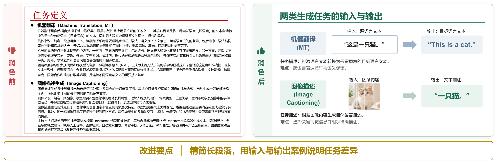
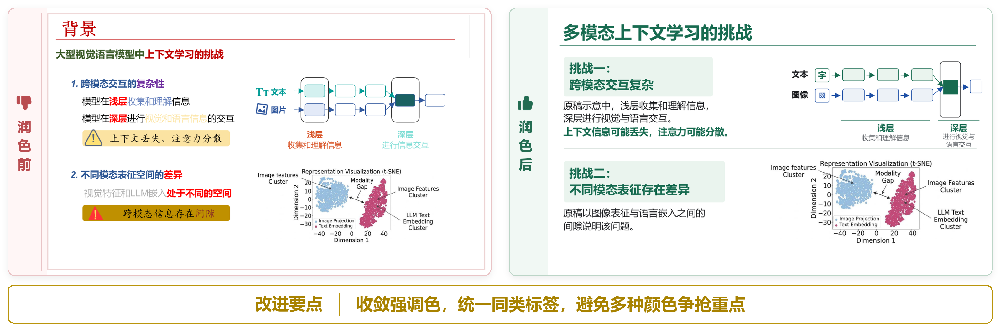
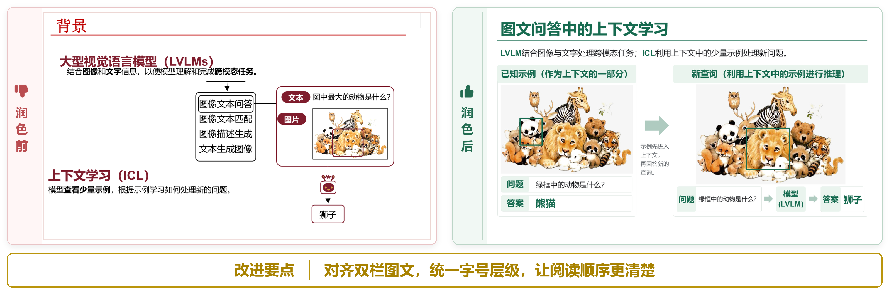
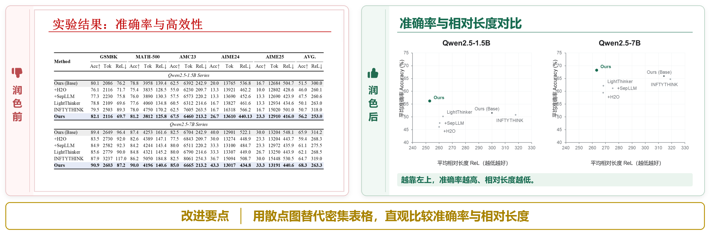

# 🧰 学术 PPT 生成与润色 Skill

[返回项目首页](../../README.md)

用于制作和润色学术汇报 PPT。可以读取论文和研究材料生成 PPT，也可以调整已有 PPT 的内容安排、布局、配色、文字和图表。

修改已有 PPT 时，先列出具体问题和改法，供使用者确认；再展示页面参考图，确认后制作可编辑的 PPTX，最后检查实际显示效果。原文件另存保留。

## 成品展示

### 学术汇报反例：润色前后对照

**调用示例**

> $paper-presentation-skill 请检查并润色反例_v1.pptx。先按 12 条汇报建议列出问题和改法，等确认后再生成页面参考图；参考图确认后，制作可编辑的 PPTX。

原稿 11 页，润色稿 20 页。下图左侧为原稿，右侧为对应的润色页。

[](../../figures/paper-presentation-skill/fanli-01-before-after.png)

[](../../figures/paper-presentation-skill/fanli-04-before-after.png)

[](../../figures/paper-presentation-skill/fanli-05-before-after.png)

[](../../figures/paper-presentation-skill/fanli-10-before-after.png)

| 原稿页 → 润色页 | 修改内容 |
| --- | --- |
| 1 → 1 | **Tip 1 · 每页字数不要太多**：把长段定义改为两组输入、输出案例，说明两个任务的区别。 |
| 4 → 7 | **Tip 4 · 颜色不要太多太乱**：减少强调色，同类标签使用相同颜色。 |
| 5 → 6 | **Tip 5 · 注意排版细节**：对齐两栏图文，统一标题和正文的字号。 |
| 10 → 14 | **Tip 10 · 实验部分多用图，少用表格**：按模型分别画散点图，比较准确率和相对长度。 |

完整文件在 [examples/](assets/examples)。文字、形状、表格和数据图表可在 PPT 中继续编辑；照片和复杂原图保留为图片。

## 开始使用

需要 Git、Python 3.10+ 和支持 Skill 的 Agent，例如 Codex 或 Claude Code。Agent 需要能读写文件、运行命令和查看图片。本机还需要 PowerPoint、WPS 或 LibreOffice，用于检查 PPTX 的显示效果。

### 1. 下载并安装依赖

在终端中运行：

```powershell
git clone https://github.com/MLNLP-World/Paper-Presentation-Tips.git
cd Paper-Presentation-Tips
python -m pip install -r skills/paper-presentation-skill/requirements.txt
```

### 2. 在 Agent 中调用

在下载的 `Paper-Presentation-Tips` 文件夹中启动 Agent，然后在聊天框输入：

- **Codex**：`$paper-presentation-skill`，后面接制作要求。
- **Claude Code**：`/paper-presentation-skill`，后面接制作要求。

例如：

> 请根据这篇论文制作一份中文组会 PPT，面向本领域研究生，汇报约 15 分钟。使用提供的背景，先展示每页参考图，确认后再制作可编辑的 PPTX。

> 请润色这份 PPT。先指出内容安排、布局、字号和图表中的具体问题，并说明怎么改。保留已经清楚的页面；修改方案和参考图确认后再制作。

在其他项目中使用的安装方法见 [使用说明](references/usage.md#安装到其他项目)。

## 制作流程

1. **读材料**：读取论文或 PPTX 中的文字、图表和公式，核对来源。
2. **确认问题和大纲**：润色时先参考本仓库的汇报建议展示具体问题和改法；制作新汇报时先确定讲述顺序和每页内容。说明哪些地方保留、哪些地方调整。
3. **设计参考图**：查看合适的模板、图表和图标，确定配色，再生成完整页面图片。
4. **聊天确认**：直接查看参考图，按页提出修改意见或确认。
5. **制作 PPTX**：按确认的图片制作文字、形状、表格、图表和公式。
6. **检查成品**：用 PPT 软件打开生成文件，导出页面图片，检查错字、小字、遮挡和排版，再修正。

默认使用 Agent 自带的绘图工具。没有绘图工具时，可以使用已配置的在线绘图服务，也可以提供参考图，或选择直接制作可编辑草稿供预览。具体方法见 [生图方式](references/usage.md#生图方式)。

## 📚 文档与资源

| | 文档与资源 | 用途 |
|:---:|---|---|
| 📘 | [使用说明](references/usage.md) | **第一次使用从这里开始**：安装、准备材料、调用与按页反馈 |
| 📖 | [Skill 入口](SKILL.md) | Agent 制作 PPT 时读取的核心步骤和规则 |
| 🧭 | [制作流程](references/workflows/) | 从论文生成、润色已有 PPT、复刻参考页等流程 |
| 🎨 | [模板与素材](assets/templates/README.md) | 查看风格、版式、图表、表格和图标 |
| 🖼️ | [页面参考示例](references/positive-examples.md) | 查看 11 页示例及可复用的组件 |
| 🛠️ | [脚本工具](scripts/README.md) | 查看读取、制作、渲染和导出工具的用法 |
| 🧩 | [成品示例](assets/examples) | 查看润色前后的完整 PPTX |
| ⚙️ | [在线绘图配置](.env.example) | 为没有内置绘图工具的 Agent 配置绘图服务 |
| ❓ | [常见问题](references/usage.md#常见问题) | 处理找不到 Skill、加载旧版本、字体错位等情况 |

<sub>完整文件 → <a href="./">Skill 目录</a></sub>

## 来源与许可证

基于 [Hugo He / PPT Master](https://github.com/hugohe3/ppt-master)，保留其模板、素材和可编辑 PPTX 制作工具，并加入学术汇报设计、问题确认和逐页参考图流程。

代码使用 [MIT 许可证](LICENSE)。图标和音效等素材的许可分别见 [图标许可](assets/templates/icons/THIRD_PARTY_NOTICES.md) 和 [音效许可](assets/templates/sounds/THIRD_PARTY_NOTICES.md)。
